<div align="center">

# ♠ ACE Pitch Day

**三分鐘，讓全場為你全押。**

ACE Club 天使輪路演的活動網站。一人一個作品，台下每個人都是天使投資人。

[**pitch.tsaicy.dev**](https://pitch.tsaicy.dev) · [English](https://pitch.tsaicy.dev/en/) · [宣傳影片](public/video.mp4)

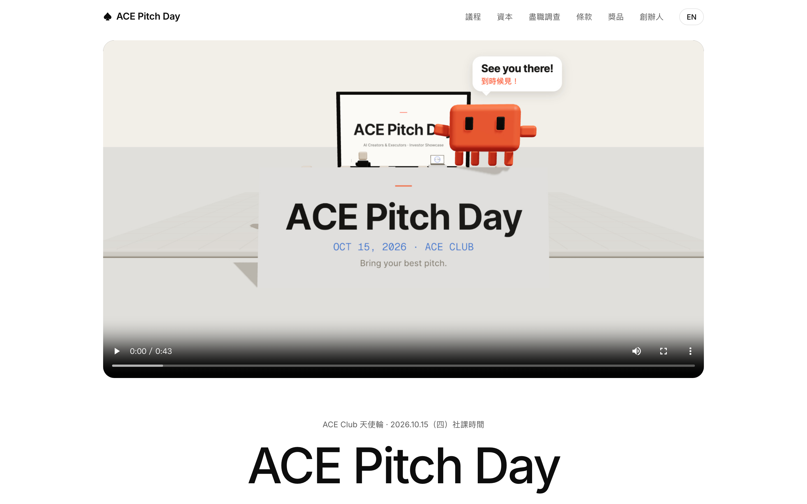

</div>

---

## 這是什麼

ACE Pitch Day 是 ACE Club 在 2026.10.15 社課舉辦的路演活動。每位創辦人有 3 分鐘上台介紹自己的作品，台下同學拿到一筆金額保密的 ACE 幣，聽完所有路演後把錢投給看好的新創，募到最多的人勝出。

這個 repo 收錄了活動用到的所有東西：

| | 內容 | 位置 |
|---|---|---|
| 🌐 | 活動規則網站（中／英雙語），部署在 Cloudflare Workers | [`public/`](public) |
| 🎬 | 43 秒 3D 宣傳影片，連同完整的製作原始檔 | [`promo/`](promo) |
| 💵 | 現場發放的 ACE 幣鈔票，A4 列印版 | [`print/`](print) |

## 宣傳影片

<div align="center">
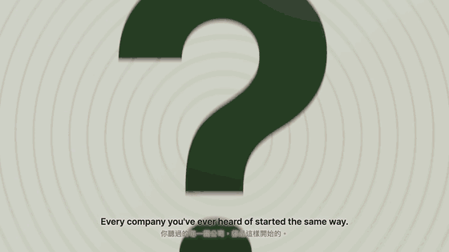
</div>

一顆鏡頭從信封裡拉出來，一路飛過教室、講台和投資箱，最後退成桌上的一座模型教室，中間不剪接。英文旁白、中英字幕和音效都是程式產生的。

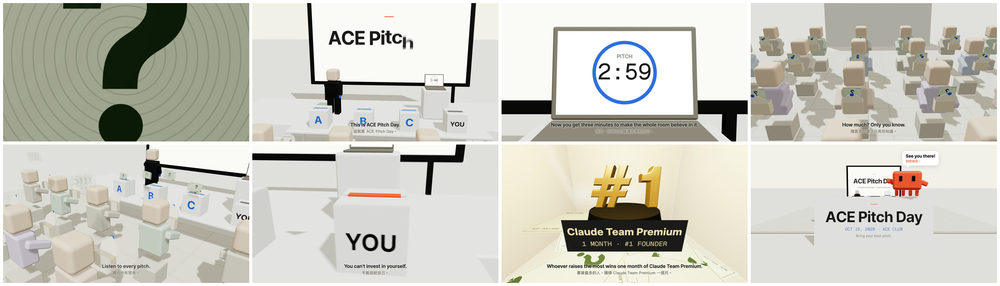

完整影片：[`public/video.mp4`](public/video.mp4)（1920×1080，43.5 秒），網站首頁也有嵌入。

## 網站導覽

網站是單頁，由上往下依序是這幾段：

### 議程：路演當天怎麼進行

時間軸捲動到畫面裡時會由左往右畫出來，「創辦人路演」底下的長條標出 3 分鐘 Pitch 和 1 分鐘提問。

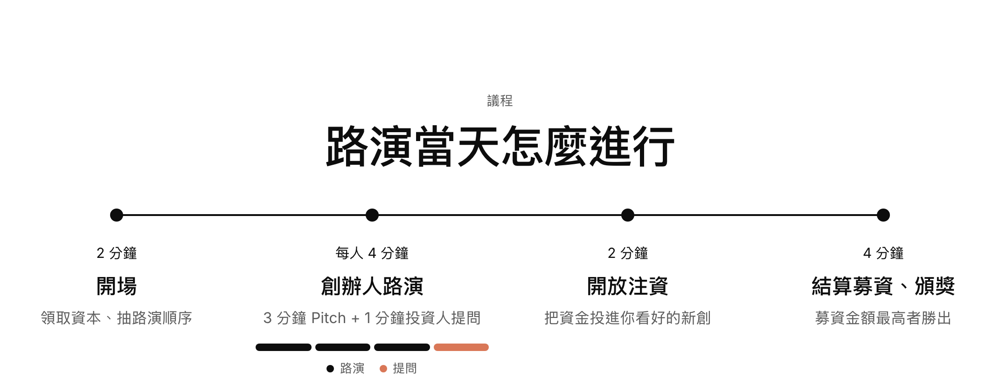

### 資本：每位投資人的資本都不一樣

用三張插圖說明投資流程，下面那張 ACE 幣的金額是模糊的，對應「拆開之前誰都不知道」。


### 盡職調查：注資前，先做功課

給投資人的四個評分角度：痛點、解法、MVP、差異化。


### 條款、獎品、創辦人

<table>
<tr>
<td width="50%">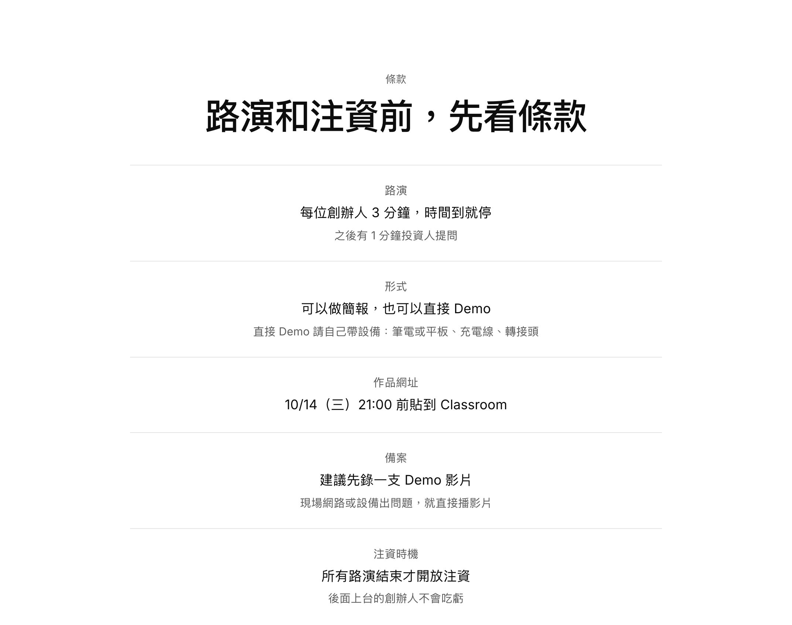</td>
<td width="50%">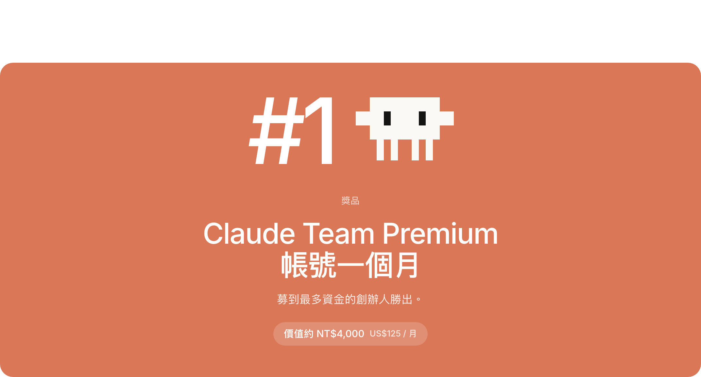</td>
</tr>
<tr>
<td align="center">路演形式、作品繳交期限、注資時機</td>
<td align="center">第一名獎品：Claude Team Premium 帳號一個月</td>
</tr>
</table>

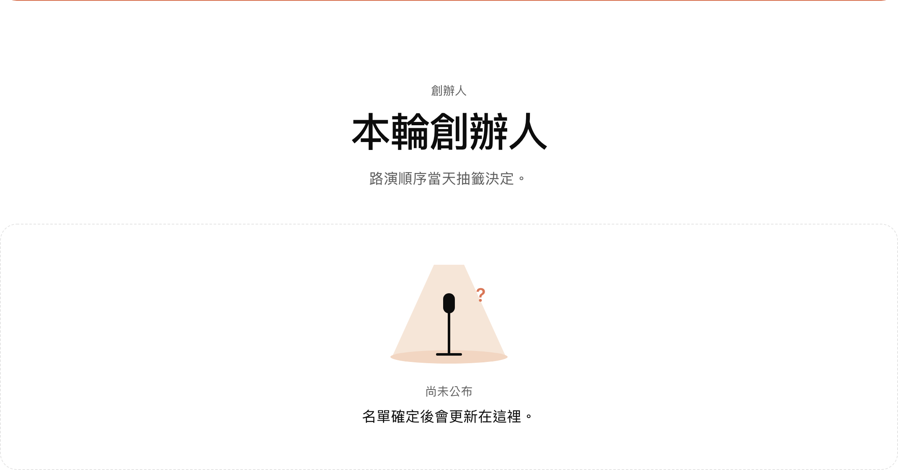

### 手機版與英文版

<table>
<tr>
<td align="center">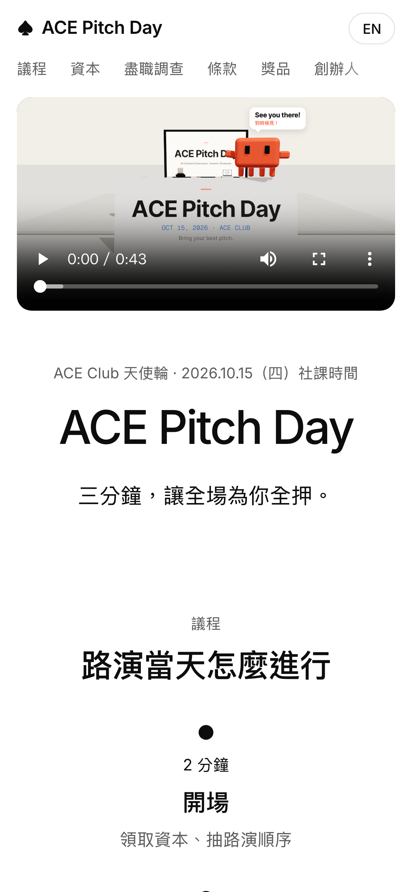</td>
<td align="center">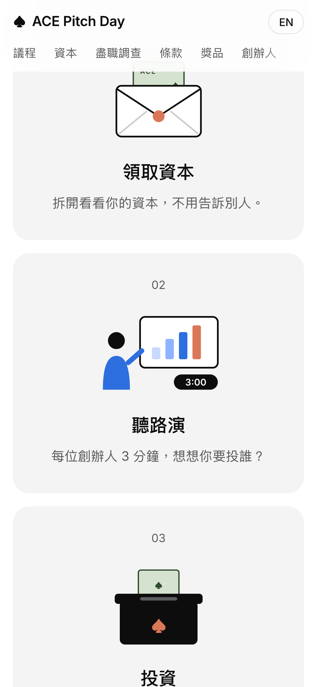</td>
<td align="center">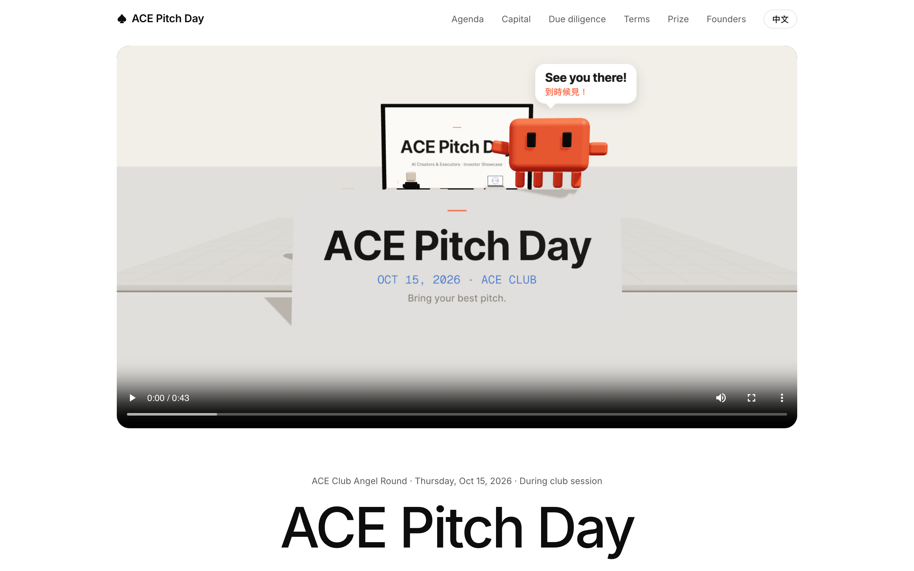</td>
</tr>
<tr>
<td align="center">手機版</td>
<td align="center">手機版：資本</td>
<td align="center">英文版 <code>/en/</code></td>
</tr>
</table>

### ACE 幣鈔票

[`print/money.pdf`](print/money.pdf) 是現場發放的鈔票，A4 一頁 12 張，每張有獨立編號。原始檔是 [`print/money.html`](print/money.html)。

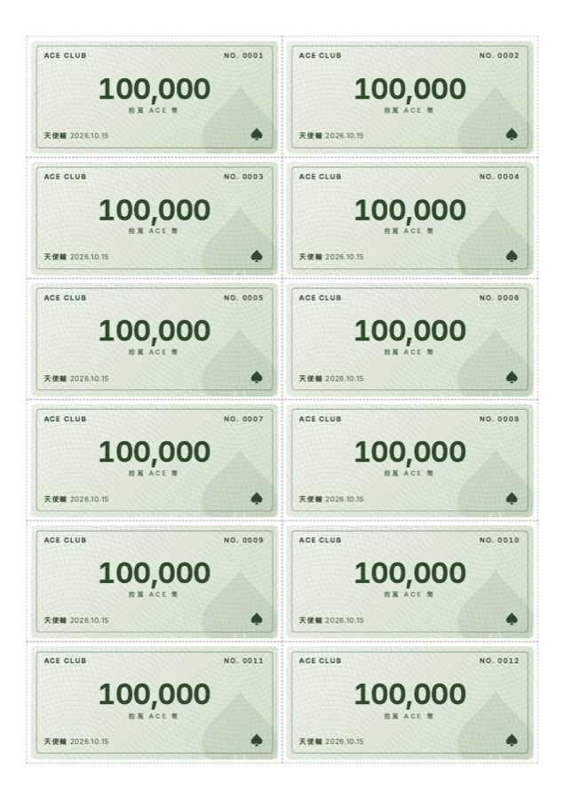

## 快速開始

網站是純 HTML / CSS / JS，沒有任何建置步驟。

### 本機預覽

```bash
git clone https://github.com/Ruxiu0409/ace-pitch-day.git
cd ace-pitch-day

# 任選一種
python3 -m http.server 8787 --directory public   # 只看靜態頁面
npx wrangler dev                                  # 用 Cloudflare Workers 的環境跑
```

兩種方式都是打開 <http://localhost:8787>，中文版在 `/`，英文版在 `/en/`。

### 部署

網站部署成 Cloudflare Worker（只放靜態檔案），設定在 [`wrangler.jsonc`](wrangler.jsonc)：

```bash
npx wrangler login    # 第一次使用才需要
npx wrangler deploy   # 上傳 public/ 並綁定 pitch.tsaicy.dev
```

要換成自己的網域，改 `wrangler.jsonc` 裡 `routes` 的 `pattern`。

### 常見修改

| 想改什麼 | 改哪裡 |
|---|---|
| 首頁影片（mp4 路徑或 YouTube 連結） | [`public/app.js`](public/app.js) 第一行的 `VIDEO` |
| 中文內容 | [`public/index.html`](public/index.html) |
| 英文內容 | [`public/en/index.html`](public/en/index.html) |
| 樣式 | [`public/style.css`](public/style.css)（中英文共用） |

## 重新製作宣傳影片

最新版影片的原始檔在 [`promo/onetake/`](promo/onetake)。整支影片是一個 three.js 場景，每個畫面都只由時間決定，所以可以一格一格渲染成影片。分鏡和每一拍的設計寫在 [`BEATS.md`](promo/onetake/BEATS.md)。

需要 Node.js、Python 3、ffmpeg，以及 Playwright 的 Chromium：

```bash
cd promo/onetake
npm install
pip install playwright numpy pillow soundfile scipy
python -m playwright install chromium

# 1. 打包場景：src/main.js → comp.js
npx esbuild src/main.js --bundle --outfile=comp.js

# 2. 在瀏覽器打開 comp.html 預覽

# 3. 逐格渲染（含動態模糊），輸出 JPEG 到 frames/
python render_lowdisk.py comp.html --out frames/ --workers 6

# 4. 合成畫面
ffmpeg -framerate 30 -i frames/%05d.jpg -c:v libx264 -pix_fmt yuv420p -crf 18 draft.mp4
```

> [!NOTE]
> 音效和配樂由 `dump_events.py` 加 `score.py` 產生，會用到 Claude Code onetake skill 內建的 `sfx_palette`（路徑寫死在 `~/.claude/skills/onetake/scripts`），沒有這個 skill 的話可以直接用現成的 `public/video.mp4`。旁白是用 Kokoro TTS 預先產好的，放在 `vo/`。

`promo/` 底下的 `scene.html`、`scene2.html` 是前兩版影片，留著當參考。

## 專案結構

```
ace-pitch-day/
├── public/              網站本體（直接部署這個資料夾）
│   ├── index.html       中文版
│   ├── en/index.html    英文版
│   ├── style.css
│   ├── app.js           嵌入影片、中文斷行、捲動動畫
│   ├── video.mp4        宣傳影片
│   └── video-poster.jpg 影片封面
├── promo/
│   ├── onetake/         最新版宣傳影片原始檔（three.js + Playwright 渲染）
│   ├── scene*.html      前兩版影片
│   └── *.srt            中英字幕
├── print/               ACE 幣鈔票列印檔
├── docs/screenshots/    README 用的截圖
└── wrangler.jsonc       Cloudflare Workers 設定
```
